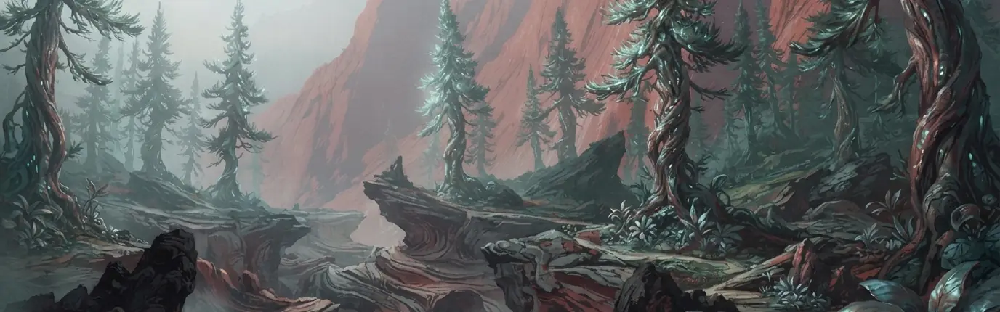

The AI Canvas is where you make creative. You add **nodes** — prompts, references, generators, edits, and delivery steps — and connect them into a graph that produces images and video. Every generation is grounded in your brand book, and everything you make lands in your [Library](/canvas/library).

<Note>In the sidebar, the canvas is **Canvas** under **Creative+**. The canvas header reads **Continuum Studio**. They're the same place.</Note>

## Workflows, not just outputs

A single prompt gives you a single image. A graph gives you a way of working you can run again. Swap the product photo, rerun, and get the same treatment on a new subject. Save the graph as a [workflow](/canvas/workflows), or publish it as a [pipeline](/canvas/pipelines) your team and your AI assistant can run with new inputs.

## What's on the canvas

| Area | What it's for |
| --- | --- |
| **The canvas** | An infinite surface where you place and connect nodes. Right-click anywhere for **Canvas Actions**. |
| **Toolbar** | **Run Flow**, **Rerun all**, **Abort**, and the **Elements** button. |
| **Side buttons** | Browse your media library, import media from Instagram, search Unsplash photos, and browse styles. |
| **Composer** | The canvas agent. Describe a workflow and it builds it. Use `@` for skills, Elements, or Library media, and `/` for shortcuts. |
| **Workspaces** | Tabs across the top. Each workspace is its own canvas for the brand. |

## In this section

| Page | What it covers |
| --- | --- |
| [Working on the canvas](/canvas/working-on-the-canvas) | Add, connect, run, save, and collaborate. |
| [Nodes](/canvas/nodes/overview) | How nodes connect and run: [image](/canvas/nodes/image), [video](/canvas/nodes/video), [text, audio, and documents](/canvas/nodes/text-audio-documents), [actions and tools](/canvas/nodes/actions), and [delivery](/canvas/nodes/delivery). |
| [Models](/canvas/models) | The image and video models you can pick on a generation node. |
| [Workflows](/canvas/workflows) | Save, load, and rerun graphs. |
| [Pipelines](/canvas/pipelines) | Publish a graph your team and your assistant can run with new inputs. |
| [Elements](/canvas/elements) | A saved product, model, or character that stays consistent everywhere. |
| [Skills and grounding](/canvas/skills-and-grounding) | How your brand book and creative skills steer every generation. |

Elsewhere in Creative+:

| Page | What it covers |
| --- | --- |
| [Video Studio](/canvas/video-studio) | Edit video on a timeline and export it. |
| [Library](/canvas/library) | Every creative, with versions, review, and share links. |
| [Forge](/forge/overview) | Fill design templates to make many versions: [agent quickstart](/forge/agents), [functions](/forge/functions), [design systems](/forge/design-systems), and [After Effects delivery](/forge/after-effects/overview) ([preparing](/forge/after-effects/preparing), [delivery and handoff](/forge/after-effects/delivery)). |
| [Brand Spy](/brand/spy) | Competitor organic posts and paid ad creatives. |

## From idea to delivery

<Steps>
<Step title="Start a graph">
Right-click the canvas and add a node, load a pre-made workflow, or describe what you want to the Composer.
</Step>
<Step title="Add references">
Drag in product shots, Elements, or Library media, and connect them to a generation node.
</Step>
<Step title="Generate and iterate">
Pick a [model](/canvas/models), run the node, and adjust. **Run Flow** reruns only what changed.
</Step>
<Step title="Deliver">
Export files, send creative to a [Planner draft](/canvas/nodes/delivery), post it, or replace the creative on a Meta ad.
</Step>
</Steps>

## Plans and credits

The canvas is included with the Organic+ plan. Generation draws on the brand's **Canvas credits**. See [Billing](/settings/billing) for your balance and [Providers and rates](/providers-and-rates) for what each generation costs.

## Try it

Ask Claude or ChatGPT to build and run a graph for you:

- "Turn this product photo into three vertical lifestyle images for Reels."
- "Make two square images of our cold brew on a sunny café table, and put the better one on Friday's post."
- "Which canvas workflows have we saved?"

If the canvas is open in Continuum, you can watch it work. See [Make creative](/mcp/use-cases/creative).

## What's next

<CardGroup cols={2}>
<Card title="Working on the canvas" icon="hand-pointer" href="/canvas/working-on-the-canvas">
  Add, connect, run, save, and collaborate.
</Card>
<Card title="Pipelines" icon="layer-group" href="/canvas/pipelines">
  Publish a graph your team can run with new inputs.
</Card>
</CardGroup>
